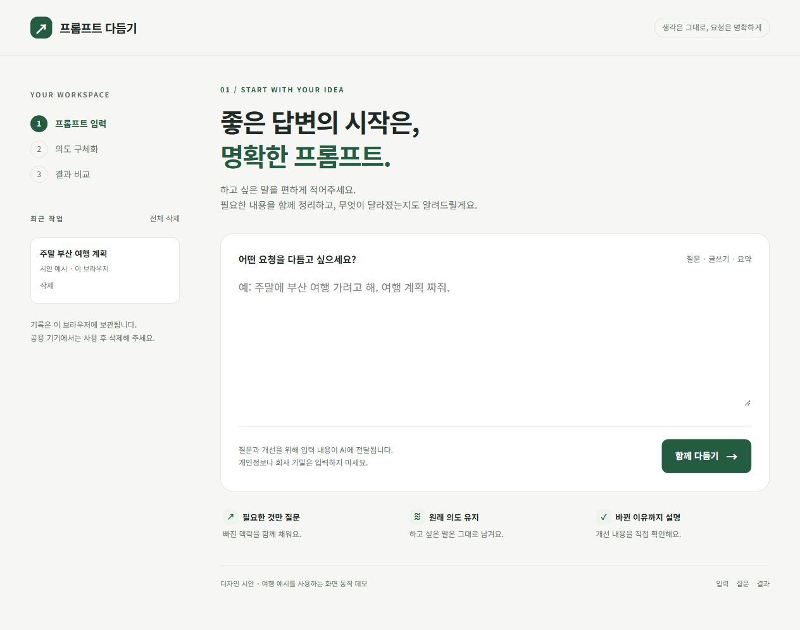
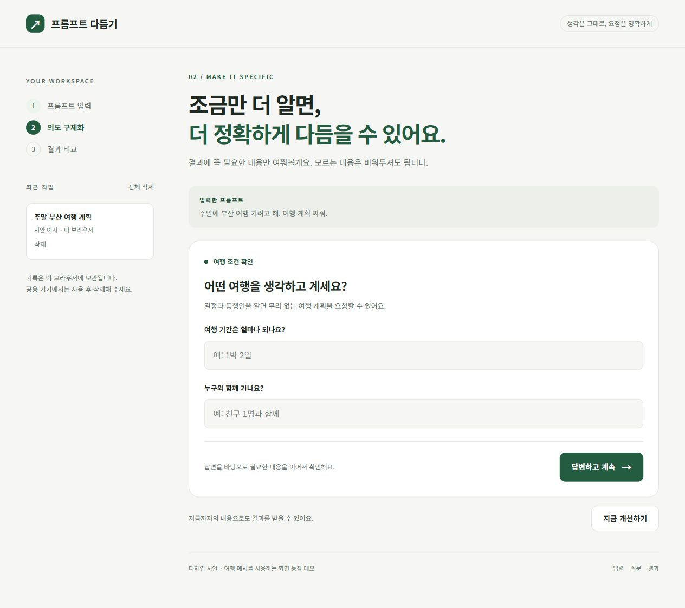
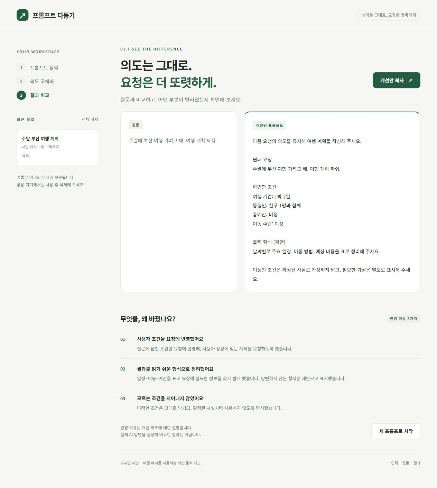

# 프롬프트 다듬기

일반 사용자가 입력한 프롬프트를 질문으로 구체화하고, 개선안과 변경 이유를 비교하는 서비스의 기획 및 디자인 시안입니다.

## 현재 상태

- PRD: 확정 완료
- 디자인: 3개 화면 제작 및 PC·모바일 검토 완료, 최종 구현 기준 승인 대기
- 실제 AI 연결 및 범용 프롬프트 개선: 아직 구현되지 않음

## 파일

- `docs/prd.md`: 제품 요구사항과 범위
- `docs/design-prompt.md`: 화면별 디자인 기준과 검토 결과
- `docs/setup.md`: 기획 과정 설정
- `design/index.html`: 클릭 가능한 HTML 시안
- `design/*.jpg`: PC·모바일 화면 캡처

## 시안 보기

`design/index.html`을 브라우저로 열면 입력 → 질문·답변 → 결과 비교 화면을 확인할 수 있습니다. 하단의 입력·질문·결과 링크로 바로 이동할 수 있습니다.

여행 예시를 사용하는 화면 동작 데모입니다. 질문과 개선 결과는 실제 AI 생성이 아니며, 최근 작업도 영구 저장되지 않습니다. 다른 요청을 입력해도 여행 예시 질문이 표시됩니다.

## 화면 미리보기

