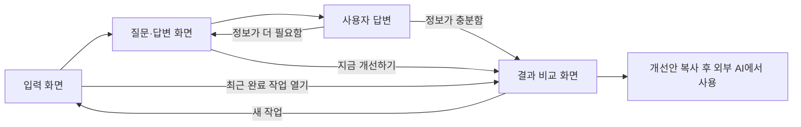

# 프롬프트 개선 서비스 PRD
상태: 완료

## 1. 서비스 한 줄 소개
사용자가 프롬프트를 입력하면 AI가 의도를 살려 더 좋은 프롬프트로 바꿔주는 서비스.

## 2. 타깃과 문제 및 대체재
- 타깃: 질문·글쓰기·요약 등에 AI를 사용하며, 프롬프트를 개선해도 무엇이 좋아졌는지 판단하기 어려운 일반 사용자.
- 주된 문제: AI에게 "프롬프트를 개선해줘"라고 해도 무엇이 좋아졌는지 알기 어렵다. 사용자가 선택한 문제 상황이다.
- 현재 대안: 기존 AI 채팅에서 프롬프트 개선을 요청한다.
- 제공 가치: 부족한 정보를 질문으로 보완하고 원문·개선안·변경 이유를 함께 보여줘 사용자가 변경 내용을 이해하고 의도 유지 여부를 판단하도록 한다.

## 3. 핵심 기능과 부가 기능
- 필수 기능 1: 입력 프롬프트에서 부족하거나 모호한 정보를 찾아 사용자에게 먼저 질문한다. 목적: 일반 사용자의 의도를 AI가 임의로 추측하지 않도록 보완한다.
- 필수 기능 2: 사용자의 답변을 반영해 원래 의도를 유지한 개선 프롬프트를 생성한다. 목적: 질문·글쓰기·요약 등 일상적인 AI 요청을 명확하게 전달한다.
- 사용자 선택: 즉시 개선이나 선택적 추가 질문 대신, 부족한 정보를 먼저 질문한 뒤 개선하는 방식(B).
- 질문 방식: 요청이 충분히 구체화될 때까지 필요한 후속 질문을 이어간다. 고정 질문 수는 두지 않는다. 사용자는 긴 대화가 가능하다는 설명을 보고 C를 선택했다.
- 질문 종료 방식: AI가 필요한 정보가 충분하다고 판단하면 결과를 생성한다. 사용자는 질문 도중 "지금 개선하기"를 선택할 수 있으며, 빠진 조건은 미정으로 표시한다.
- 질문 충분성 기준: 목적, 원하는 결과, 결과에 영향을 주는 필수 조건이 명확하고 서로 충돌하지 않으면 종료한다. 요청에 필요 없는 조건은 질문하지 않는다. 이미 답한 질문을 반복하지 않으며, 모른다고 답한 조건은 미정으로 두거나 제안임을 표시한다. (추천 수용)
- 질문 진행: 한 번에 질문 1~2개를 제시하고, 답변에 따라 후속 질문을 정한다. 구체적인 입력이면 불필요한 질문 없이 결과를 생성할 수 있다. 질문 수에 고정 상한을 두지 않는다. (추천 수용)
- 개선 품질: 원문과 답변의 목적·사실·필수 조건을 유지한다. 요청에 필요한 맥락과 출력 형식을 정리하고, 답하지 않은 정보는 사실처럼 만들어 넣지 않는다. 장황한 역할 지시나 의미 없는 수식어를 자동으로 덧붙이지 않는다. (추천 수용)
- 결과 표시: 원문·개선안 비교, 변경 이유, 복사 버튼을 제공한다. 이유: 사용자가 개선 효과와 원래 의도 유지 여부를 확인하고 결과를 사용할 수 있도록 한다.
- 확정 흐름: 원문 입력 → 부족한 정보 질문 → 사용자 답변 및 필요한 후속 질문 → 개선 결과와 원문 비교·변경 이유 확인 → 복사.
- 변경 이유: 주요 변경마다 원문의 문제, 개선한 내용, 기대 효과를 짧게 연결해 설명한다. 실제 AI 답변을 실행해 검증한 결과로 표현하지 않는다. 예: "답변 분량을 명시해 지나치게 긴 결과를 줄이도록 했습니다." (추천 수용)
- 부가 기능: 같은 브라우저의 최근 작업 다시 열기, 개별·전체 기록 삭제. 필수 기능을 보조하는 편의 기능으로 포함한다. (추천 수용)

## 4. 화면 목록과 이동 흐름
- 주 사용 기기: PC와 모바일 반응형 — 모바일 단일 열을 기본으로 PC에서 비교 영역을 확장한다. 디자인 단계에서 AI 추천 수용.
- 입력 화면: 원문 프롬프트를 입력하고 질문 과정을 시작한다. 최근 작업을 다시 열거나 삭제할 수 있다. 최근 기록은 별도 화면을 만들지 않고 이 화면에 표시한다. (추천 수용)
- 질문·답변 화면: 부족한 정보를 묻고 답변을 받는다. 필요한 후속 질문을 이어가며 "지금 개선하기"로 중간 종료할 수 있다.
- 결과 비교 화면: 원문·개선안·변경 이유를 확인하고 개선안을 복사한다. 새 프롬프트 작업을 시작할 수 있다. (추천 수용)
- 화면 3개를 단계별로 구성한다. 사용자는 완성된 프롬프트를 평소 사용하는 AI에서 직접 실행한다.

## 5. 저장할 데이터와 데이터 사용 원칙
- 저장 방식: 로그인 없이 같은 브라우저에 작업 기록을 보관한다. 계정이나 기기 간 동기화는 제공하지 않는다. (추천 수용)
- 저장할 데이터: 작업 ID, 원문, 질문·답변, 개선안, 변경 이유, 진행 단계, 생성·수정 시각. (추천 수용)
- 보관 범위: 진행 중 작업 1개와 최근 완료 작업 20개. 완료 기록이 20개를 넘으면 가장 오래된 완료 기록을 제거한다. (추천 수용, 최종 확인 완료)
- 기록 제어: 개별 삭제와 전체 삭제를 제공한다. 저장이 불가능해도 현재 작업을 진행할 수 있도록 안내하며, 공용 기기에서 기록이 남는다는 점을 알린다. (추천 수용)
- AI 처리: 질문과 개선을 위해 원문과 필요한 질문·답변을 AI 처리 서버로 전달한다. 브라우저 기록 보관과 AI 전송은 구분해 안내한다. 서비스 서버의 영구 대화 기록 저장은 첫 버전에서 제외한다. AI 제공자의 보관 정책은 기술 설계 단계에서 확인한다. (추천 수용)
- 개발과 검증에는 직접 만든 예시 프롬프트를 사용한다. 회사 기밀이나 타인의 개인정보가 포함된 실제 자료는 사용하지 않는다.

## 6. 제외 범위
- 서비스 내부에서 원문 또는 개선 프롬프트를 실행해 AI 답변을 생성하는 기능.
- 원문·개선안을 실행한 실제 AI 답변 비교.
- 회원가입·로그인, 계정별 클라우드 기록 보관, 기기 간 동기화. (추천 수용)
- 결제·구독, 팀 공유, 공개 프롬프트 모음, 파일 업로드. (추천 수용)
- 여러 AI 모델 선택과 모델별 전용 최적화. 첫 버전은 범용 텍스트 프롬프트에 집중한다. (추천 수용)
- 서비스 완료 기준은 로컬 실행이며 공개 배포는 선택 후속 범위로 둔다. (추천 수용)

## 7. 성공 기준
- 이해도: 대상에 해당하는 시험 사용자 5명 중 4명 이상이 결과를 보고 변경된 점과 그 이유를 1개 이상 설명한다. (추천 수용)
- 의도 유지: 직접 만든 예시 10개 중 9개 이상에서 원문과 답변의 목적·필수 조건을 유지하고, 답하지 않은 조건을 사실처럼 추가하지 않는다. 두 조건을 모두 만족해야 해당 예시를 통과로 판정한다. (추천 수용)
- 검증 방법: 질문·글쓰기·요약 예시를 골고루 포함하고, 모호한 요청·구체적인 요청·조건 충돌·모른다는 답변·중간 생성 사례를 넣는다. 숫자는 출시 전 목표이며 달성 여부는 구현 후 평가한다. (추천 수용)

## 8. 예상 복잡도
- 보통 — 화면 3개와 브라우저 기록 저장으로 구성되지만, 여러 차례 질문의 맥락 관리와 개선 품질 검증이 필요하다. 단일 사용자 역할과 로그인·결제 없는 범위여서 AI와 함께 만드는 1인 첫 버전으로 감당할 수 있다.
- 복잡도를 높이는 요인: 질문 종료 판단, 조건 충돌 처리, 변경 이유와 실제 수정의 일치, 생성 지연·실패 처리, AI 사용 비용.

## 최종 확인
- 사용자는 "계속 ㄱㄱ 최적화시켜서 추천으로 해줘"라고 요청했다. 남은 설계 선택은 추천안으로 채우고 `(추천 수용)`을 표시했다.
- 타깃·핵심 기능·제외 범위·성공 기준 및 진행 중 작업 1개·최근 완료 작업 20개라는 보관 개수를 요약해 제시했다.
- 사용자의 "호가정"을 문맥상 "확정"으로 이해해 최종 확인을 반영했다. 남은 미확정 항목은 없다.

## 과정 설정
- 진행 모드: 꼼꼼.
- 진행 모드 A, 타깃 A, 핵심 기능 B, 질문 방식 C, 결과 구성 B, 종료 방식 B, 주된 문제 C, 화면 구성 A, 첫 버전 검증 범위 A를 선택했다.
